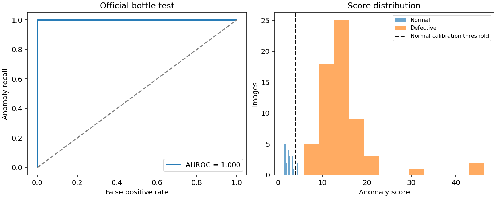
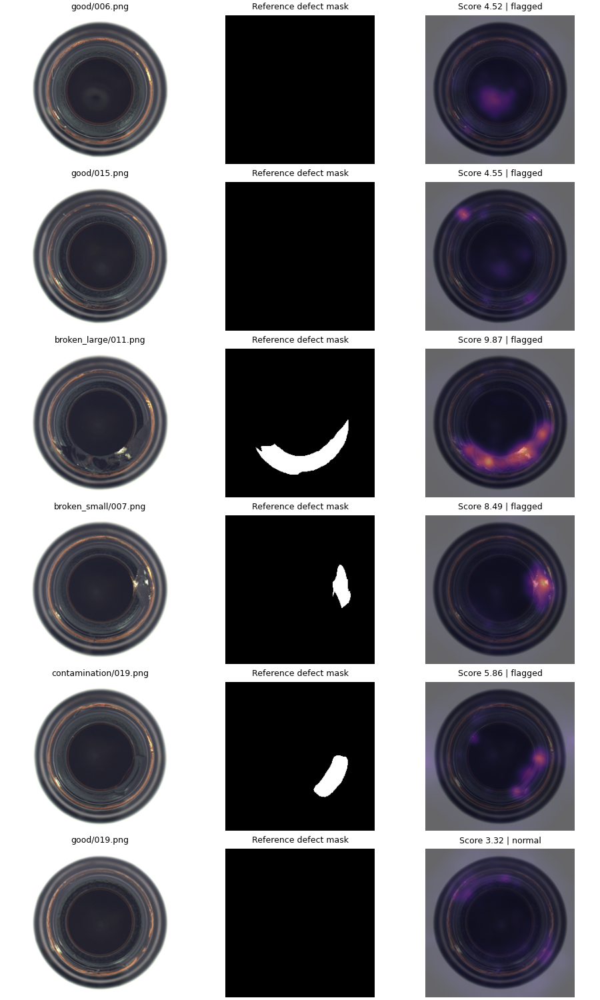

# Industrial Anomaly Detection

[](https://github.com/shmuradd/industrial-anomaly-detection/actions/workflows/ci.yml)

**Learn what a normal bottle looks like, then locate unusual regions.** This computer-vision project fits spatial Gaussian statistics to frozen ResNet18 features using only defect-free training images. It includes a fitted model, a guided notebook, normal-only threshold calibration, pixel-level evaluation, and visual error inspection.



## Measured results

One fixed configuration, seed 42; MVTec AD **bottle** category only. The official training set is divided into 167 fitting images and 42 normal calibration images. No defective image or test label is used for fitting, threshold selection, or configuration selection.

| Metric | Official bottle test |
| --- | ---: |
| Test images | 83 (63 defective, 20 normal) |
| Image AUROC | 1.000 |
| Image average precision | 1.000 |
| Pixel AUROC at 256 × 256 | 0.9840 |
| Detected defective images | 63 / 63 |
| Normal images incorrectly flagged | 2 / 20 |
| Threshold from held-out normal images | 3.8109 |

AUROC measures ranking, while the calibrated threshold determines the actual flags. The 10% test false-positive rate is reported explicitly; a 5% calibration target does not promise exactly 5% errors on a small, fixed test set. These results establish a baseline on one category, not production readiness or performance across all MVTec categories.

## Quick start

Python 3.12, CPU supported. Run from the repository root:

```bash
python -m venv .venv
source .venv/bin/activate
pip install torch==2.14.1 torchvision==0.29.1 --index-url https://download.pytorch.org/whl/cpu
pip install -e '.[dev,notebook]'
python scripts/download_data.py
inspect-bottles evaluate
inspect-bottles predict --image data/bottle/test/broken_small/000.png --output reports/prediction.png
```

The fitted statistics are included in `models/bottle_gaussian.npz` (about 1.2 MB). TorchVision downloads the official ImageNet ResNet18 weights on first use; network access is needed once. The model loads NumPy arrays with `allow_pickle=False`.

Reproduce fitting and evaluation:

```bash
inspect-bottles fit
inspect-bottles evaluate
python -m unittest discover -s tests -v
ruff check .
ruff format --check .
jupyter lab notebooks/industrial_anomaly_detection.ipynb
```

The download script uses a **third-party mirror**, checks the exact archive SHA-256 before extracting, and applies Python's safe tar extraction filter. The original dataset is available from [MVTec](https://www.mvtec.com/research-teaching/datasets/mvtec-ad). The mirror checksum identifies the archive used here; it is not a vendor signature. You may instead obtain the original bottle category and place it under `data/bottle/` with `train/`, `test/`, and `ground_truth/` subfolders.

## How inspection works

1. Resize RGB images to 256 × 256 and normalize with ImageNet channel statistics.
2. Take frozen ResNet18 layer1 and layer2 features; average-pool layer1 to the layer2 grid and concatenate 192 channels on a 32 × 32 grid.
3. Fit an independent mean and regularized variance for every channel and grid position using only the 167 fitting images.
4. Score deviations with a diagonal Gaussian distance, upsample and smooth the map, then average its strongest 1% to obtain an image score.
5. Choose a finite-sample upper quantile using 42 separate normal images. Flag a score strictly above this threshold.

This is a deliberately simple **spatial diagonal Gaussian baseline**, inspired by feature-distribution anomaly detection. It is not a full PaDiM or PatchCore reproduction. There is no defect-class classifier or fine-tuned neural backbone.

## Inspect predictions



The gallery includes the two false alarms, the closest-to-threshold example of each defect type, and a nearby remaining decision. It includes the original image, reference defect mask, and distance overlay. Heatmaps show feature deviations rather than causal explanations or segmentation probabilities.

## Repository guide

| Path | Purpose |
| --- | --- |
| `src/inspection/` | Data handling, frozen features, scoring, calibration, CLI |
| `notebooks/industrial_anomaly_detection.ipynb` | Executed walkthrough and optional reproduction |
| `models/bottle_gaussian.npz` | Fitted normal statistics and threshold |
| `configs/bottle.json` | Recorded benchmark settings |
| `reports/bottle/` | Metrics, predictions, split manifest, figures, provenance |
| `docs/methodology.md` | Formulas, evaluation scope, limitations |
| `tests/` | Scoring, calibration, split, and encoder checks |
| `.github/workflows/ci.yml` | Lint, formatting, and offline unit tests |

## Limitations and next experiments

Bottle images have fairly consistent alignment and illumination. Position-specific statistics may fail with camera movement, new bottle shapes, reflections, or changed lighting. Diagonal variance ignores correlations between channels. Resize-based pixel AUROC is not the official full-resolution AU-PRO protocol, and abundant background pixels can make pixel AUROC optimistic. Small normal calibration and test sets limit false-alarm estimates.

Useful next experiments are multiple categories, controlled lighting and alignment shifts, comparison with full-covariance or nearest-neighbor methods, and a separate validation protocol for selecting configurations. Do not tune on this test set and continue presenting it as untouched.

## Sources and data terms

- [MVTec AD dataset and license](https://www.mvtec.com/research-teaching/datasets/mvtec-ad), Paul Bergmann, Michael Fauser, David Sattlegger, Carsten Steger; CVPR 2019.
- [PaDiM: a Patch Distribution Modeling Framework for Anomaly Detection and Localization](https://arxiv.org/abs/2011.08785), Defard et al.; methodological context, not an implementation-equivalence claim.
- [TorchVision ResNet18 documentation](https://docs.pytorch.org/vision/stable/models/generated/torchvision.models.resnet18.html).
- [Archive mirror](https://huggingface.co/datasets/XavierZXY/MvT-tar).

MVTec images are © MVTec Software GmbH and released under **CC BY-NC-SA 4.0**. The image-containing inspection figure adapts those images and is shared under the same license with this attribution. Dataset-derived model statistics are provided for noncommercial research under those terms. Raw dataset images are not committed. See [NOTICE.md](NOTICE.md).
